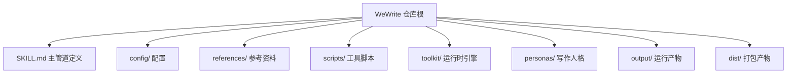

# WeWrite 目录架构

一页看懂每个目录的职责。`{skill_dir}` = 仓库根目录。

## 顶层目录职责

| 目录 / 文件 | 职责 | 是否入库 |
|------------|------|---------|
| `SKILL.md` | 技能主定义：8 步主管道 + 行为声明 + 路径约定 | 是 |
| `README.md` | 对外说明与快速开始 | 是 |
| `install.sh` | 创建 `.venv` 并安装依赖 | 是 |
| `requirements.txt` | Python 依赖清单 | 是 |
| `VERSION` | 版本号 | 是 |
| `config/` | 全部配置（微信凭据、账号风格、写作参数） | 仅 `.example` 入库 |
| `references/` | 参考资料与规范（见下） | 框架入库，用户范文忽略 |
| `scripts/` | 工具脚本（检查/抓取/学习/构建），保持扁平，索引见 `scripts/README.md` | 是 |
| `toolkit/` | 运行时引擎：Markdown→微信 HTML 转换、主题、发布、配图 | 是 |
| `personas/` | 写作人格 yaml | 是（账号专属人格忽略） |
| `output/` | 运行产物：文章、配图、HTML、`history.yaml` | 仅 `history.yaml` 入库 |
| `dist/` | 打包产物：openclaw skill、codex prompt、发布 zip | openclaw/codex/zip 入库 |
| `tests/` | pytest 测试 | 是 |
| `evals/` | 评测用例 | 是 |

## config/（配置）

| 文件 | 内容 | 是否含敏感值 |
|------|------|------------|
| `config.yaml` | 微信 appid/secret、图片服务 provider/key | 是（gitignore） |
| `style.yaml` | 账号风格：人格、主题、字数区间、humanness 区间 | 否 |
| `writing-config.yaml` | 写作参数（反 AI 指纹校准结果） | 否 |

加载优先级（`toolkit/config.py` 与 `scripts/diagnose.py` 一致）：
`config/` 优先，兼容旧根目录布局，最后回退 `~/.config/wewrite/`。环境变量可覆盖敏感字段。

## references/（参考资料）

| 子目录 | 内容 |
|--------|------|
| `pipeline/` | 主管道文档：选题、框架、写作指南、内容增强、排版样式、视觉提示、实时核查 |
| `compliance/` | 合规与 SEO：SEO 规则、微信限制 |
| `guides/` | 使用指南：上手、命令分发、风格模板、改稿学习、效果复盘 |
| `examples/` | 范文库：exemplars/、source_articles/、exemplar-seeds（用户内容 gitignore） |

## toolkit/（运行时引擎）

| 文件 | 职责 |
|------|------|
| `cli.py` | 命令行入口：preview / publish / themes / gallery / image-post / learn-theme |
| `gzh_converter.py` | Markdown → 微信内联样式 HTML，含容器语法、8 种版式与整页背景 |
| `theme_base.py` | 主题共享数据类 `ThemeConfig` |
| `theme_configs.py` | 50 套主题注册（核心 7 套 + 库内代表 43 套）与 `auto` 自适应配色 |
| `theme_library.py` | 库内主题 spec、排版去重与 `ThemeConfig` 构建 |
| `publisher.py` | 草稿箱 API 封装 |
| `wechat_api.py` | 上传图片/封面色块 |
| `image_gen.py` | AI 配图生成（多 provider，支持 `--batch`） |
| `config_manager.py` | 配置加载、校验与单例缓存 |
| `config.py` | 配置加载统一出口，兼容旧调用 |

## scripts/（工具脚本）

保持扁平，按职能分组见 `scripts/README.md`：检查类、抓取类、学习类、构建类。

## 修改约定

- 改主题/规则文档后 → 重建 `dist/`：`python3 scripts/build_openclaw.py && python3 scripts/build_codex.py`
- 改配置路径 → 同步 `toolkit/config.py`、`scripts/diagnose.py`、`SKILL.md`、`install.sh`
- 用户私有内容（真实配置、范文、账号人格、生成产物）一律走 gitignore，不入库
- 回归基线：`python3 -m pytest tests/ -q` 全绿 + 实跑一次 `preview`
